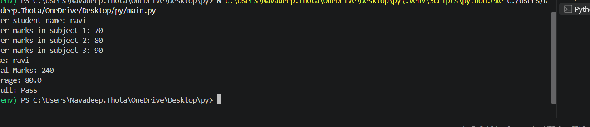
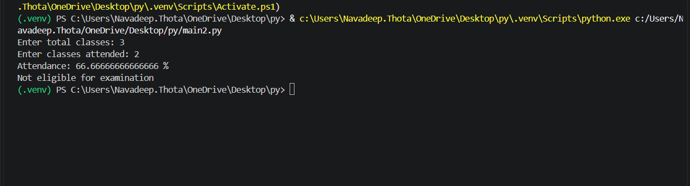
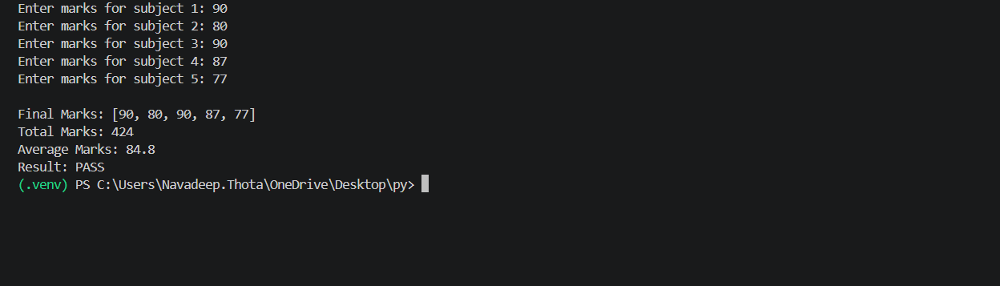
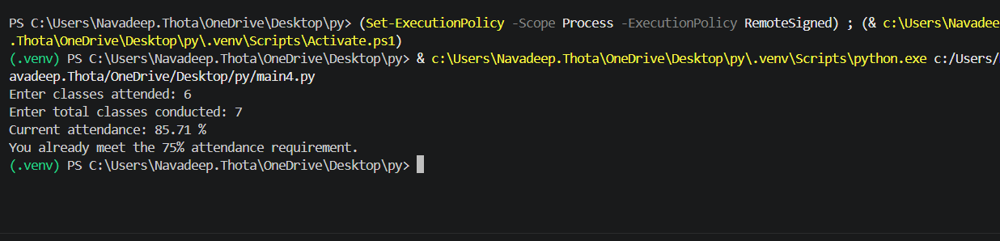
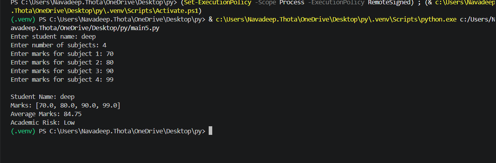
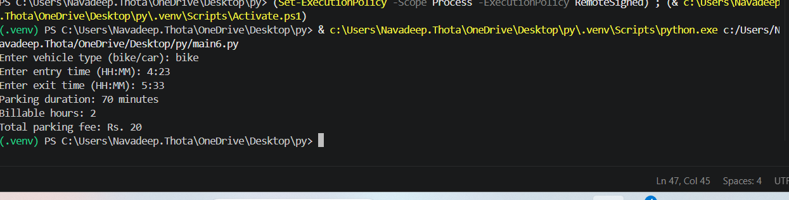
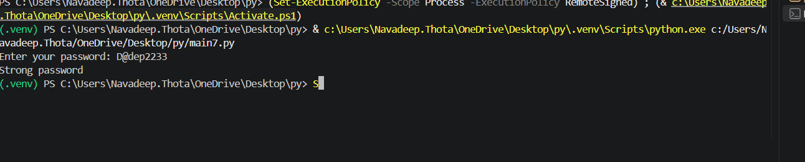
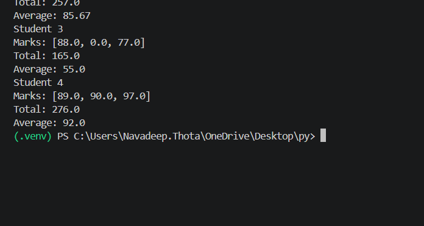
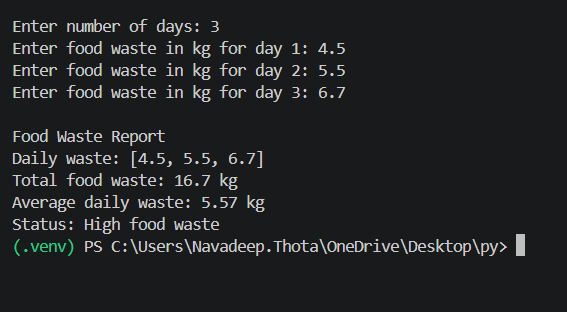
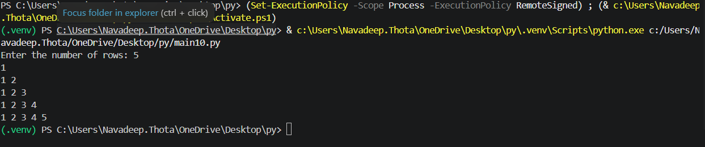

# PYTHON PROGRAMMING – ACTIVITY BASED LEARNING

**Student Name:** T. Navadeep  
**Branch:** CSE (AI & ML)  
**Year:** First Year B.Tech  
**Section:** 06
**Academic Year:** 2026–2027  

## Python Programs and Outputs

| S.No. | Python Source Code | Output Screenshot |
|:---:|:---:|:---:|
| 1 | [main.py](./main.py) |  |
| 2 | [main2.py](./main2.py) |  |
| 3 | [main3.py](./main3.py) |  |
| 4 | [main4.py](./main4.py) |  |
| 5 | [main5.py](./main5.py) |  |
| 6 | [main6.py](./main6.py) |  |
| 7 | [main7.py](./main7.py) |  |
| 8 | [main8.py](./main8.py) |  |
| 9 | [main9.py](./main9.py) |  |
| 10 | [main10.py](./main10.py) |  |

## Conclusion

This project helped me understand and practice Python programming concepts through activity-based learning.
